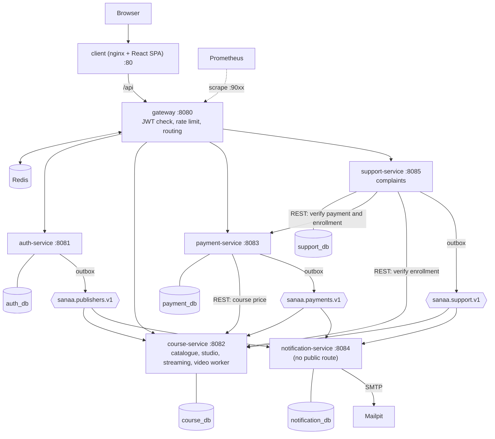

# SANAA Architecture v2 (publisher marketplace)

Status: source of truth for v1.0.0. If code and this document disagree, fix one of them in the same commit. Any deviation needs an ADR in `docs/adr/`.

This version replaces the "one academy per subdomain" model. Where it contradicts earlier ADRs, this document wins and the ADR must be updated:
- ADR 003: login no longer takes a tenant slug.
- ADR 004: the Host-versus-tenant check is removed (no subdomains).
- ADR 006 and 007: SUPER_ADMIN is no longer blocked from course and payment data; it gets audited, read-oriented oversight (section 14).

## 1. Product model

SANAA is one website with one brand, like Udemy or Coursera.

- A **publisher** is either an **INDIVIDUAL** (a solo creator) or an **ORGANIZATION** (a company with a team of teachers). Every publisher is a **tenant**: a private workspace ("studio") whose data other publishers can never read or change.
- A **learner** has a global account, browses the public catalogue, buys courses from any publisher, and has a personal dashboard.
- Each publisher chooses how it is paid. In v1.0.0: bank wire and CashPlus with a receipt that the publisher approves or rejects, plus a card payment path that uses a simulated gateway (section 11).
- After approval the learner watches the course videos in a protected player.
- A learner who paid and did not get what was promised can file a **complaint** to the platform with evidence. The platform admin (SUPER_ADMIN) reviews and decides.
- The platform admin can see everything, to protect learners from fraud. Every sensitive access is audited (section 14).

Resume claim kept: tenant isolation of data per publisher, now with explicit, narrow, tested cross-tenant read paths.

## 2. Actors and roles

| Role | Who | Powers |
|---|---|---|
| STUDENT | any learner (global account, no tenant) | browse, buy, learn, review (after enrolling), file complaints, own payments and enrollments |
| INSTRUCTOR | a teacher inside an ORGANIZATION | manage own courses, lessons, videos, discounts; see names of own students and ratings; reply to reviews of own courses |
| TENANT_ADMIN | owner of an INDIVIDUAL publisher, or admin of an ORGANIZATION | everything inside the publisher: all courses of the publisher, team (organizations only), payments review, payment settings, profile, revenue, complaints of the publisher |
| SUPER_ADMIN | platform owner | oversight and moderation across all tenants (section 14); never sells, never edits course content, never reviews receipts as a seller |

Rules:
- A solo creator is a publisher of type INDIVIDUAL with exactly one TENANT_ADMIN who also teaches. INDIVIDUAL publishers cannot add team members.
- An ORGANIZATION admin can add, disable and re-enable teachers, and can view, edit, archive or delete any course of the organization. A teacher can only manage own courses.
- A user has at most one publisher membership in v1.0.0. Publisher members may also buy courses (not their own publisher's).
- Only a TENANT_ADMIN approves or rejects payments.

## 3. System diagram

## 4. Components

| Component | Port | Management | Database | Responsibility |
|---|---|---|---|---|
| client (nginx) | 80 | none | none | SPA, proxy `/api` to the gateway, `client_max_body_size` large enough for video upload |
| gateway | 8080 | 9082 | none | JWT validation, rate limiting, routing, header sanitization, public routes |
| auth-service | 8081 | 9081 | auth_db | users, memberships, publishers, profiles, images, login, refresh, JWKS, team, admin user and publisher moderation |
| course-service | 8082 | 9083 | course_db | categories, courses, lessons, enrollments, reviews, discovery, learner home, studio, video upload and encoding worker, playback tokens and HLS delivery, admin course moderation |
| payment-service | 8083 | 9084 | payment_db | payments, receipts, review workflow, payment settings, card provider (simulated), admin payment oversight |
| notification-service | 8084 | 9085 | notification_db | consumes events, sends French emails, keeps publisher contact data, no REST API |
| support-service | 8085 | 9086 | support_db | complaints, messages, attachments, resolution |

Management ports are internal only. Infrastructure: MySQL 8.4, Redis 7, Kafka KRaft, Mailpit, Prometheus. ffmpeg and ffprobe must exist wherever course-service runs.

## 5. Multi-tenancy model

5.1 Tenant = publisher. The tenant identifier is the publisher id. Learners and SUPER_ADMIN have no tenant.

5.2 **Private data is tenant-scoped** with Hibernate `@TenantId` and the fail-closed nil-UUID rule: courses, modules, lessons, memberships, enrollments, reviews, payments, payment settings, complaints (publisher side). The tenant comes only from the validated JWT claim, or from the Kafka event envelope in consumers.

5.3 **Three cross-tenant read models** are the only way to read across tenants. They are the part to defend in an interview:
1. **Public catalogue**: anonymous, only courses with status PUBLISHED whose publisher is ACTIVE, only public columns, never private fields.
2. **Learner view**: authenticated learner, always filtered by the user id from the JWT (`sub`), never by a client parameter. Covers own enrollments, own payments, own complaints, own reviews.
3. **Admin view**: SUPER_ADMIN only, audited.

Implementation rules:
- Each read model is a separate read-only entity or projection (`@Immutable`, no `@TenantId`) in a package named `crosstenant`, with its own repository. Native SQL is allowed only in these packages and in the outbox pollers and processed-events inserts.
- Controllers that use these repositories are annotated and tested for their audience. A test (ArchUnit, test scope only) fails the build if code outside `crosstenant` packages or the allowed list uses native queries, or if a `crosstenant` repository is used by a controller of the wrong audience.
- The public DTOs never contain emails, tenant contact data, payment data, or media paths.

5.4 **Cross-tenant writes** (a learner creating a payment, a complaint, a review, a free enrollment, or an admin grant): the target tenant comes from a trusted server-side lookup of the course (never from the request), and the service runs `TenantContext.callAs(targetTenant, ...)` before the transaction opens.

5.5 Learners with no tenant claim run with an unset context. Tenant-scoped reads return nothing, which is the correct behavior.

Limits (record in `docs/adr/001-tenancy.md` and ADR 010): native SQL is unfiltered, unique indexes must include the tenant column, noisy neighbor in a shared database, the context must be set before the transaction opens.

## 6. Identity and authentication

Users are global. Memberships link a user to a publisher.

Flows:
- **Register as learner**: `POST /api/auth/register` (email, password, fullName). Role STUDENT, no tenant.
- **Create a publisher** (`POST /api/auth/publishers`): body has publisherType (INDIVIDUAL or ORGANIZATION), publisherName, slug, color, and either owner data (anonymous call, creates the user too) or nothing extra when called by a logged-in learner ("Devenir créateur"). The tenant and the TENANT_ADMIN membership are created in one transaction. A user who already has a membership gets 409. The caller then calls refresh to receive the publisher claims.
- **Login**: email and password only. No tenant slug.
- **Add a team member** (ORGANIZATION only, TENANT_ADMIN): creates a user with a temporary password and `must_change_password = true`, plus an INSTRUCTOR or TENANT_ADMIN membership. An existing email gets 409. `must_change_password` limits the session to change-password and logout until changed.
- **Disable and re-enable members** (cannot disable self, cannot disable the last active TENANT_ADMIN, also under concurrency). Disabling revokes the member's refresh tokens.
- Reserved slugs: platform, www, api, admin, app, mail, static, auth, support, help, blog, docs, status, cdn, assets, login, register, dashboard, billing, sanaa, studio, learn, courses, publishers, instructors, public.
- Slug rules: `^[a-z0-9]([a-z0-9-]{1,61}[a-z0-9])$`, no `xn--` prefix, unique.
- Password rule: 10 to 72 bytes in UTF-8 everywhere a password is set.
- A suspended publisher: login and refresh issue claims without tenant data and with role STUDENT (members become plain learners). Already issued tokens stay valid up to 15 minutes (documented).

Access token (RS256 + JWKS, 15 minutes): `iss=sanaa-auth`, `aud=sanaa-api`, `sub`, `email`, `name`, `role`, `jti`, `must_change_password`, and for publisher members only: `tenant_id`, `tenant_slug`, `tenant_type`. Refresh token: opaque, hashed, rotated, reuse detection revokes all tokens of the user, cookie `sanaa_refresh` (HttpOnly, SameSite=Strict, Path=/api/auth). Every service validates the JWT itself.

## 7. Data model

Conventions: utf8mb4, `created_at` and `updated_at`, money `DECIMAL(10,2)`, BIGINT ids (tenants and files use UUID). Tenant-scoped tables have `tenant_id CHAR(36) NOT NULL`, the nil-UUID CHECK, and an index starting with `tenant_id`. Flyway only; V2 migrations transform the existing schema and are tested by migrating a V1 database with sample rows.

### auth_db
- `users`: id, email (globally unique, lower case), password_hash, full_name, platform_role (USER or SUPER_ADMIN), status (ACTIVE, DISABLED), must_change_password, created_at. Not tenant-scoped.
- `tenants`: id, slug (unique), name, type (INDIVIDUAL, ORGANIZATION), status (ACTIVE, SUSPENDED), primary_color, headline, description, website_url, instagram_url, linkedin_url, youtube_url, logo_image_id, contact_email, created_at.
- `memberships`: id, tenant_id (`@TenantId`), user_id (UNIQUE), role (TENANT_ADMIN, INSTRUCTOR), status (ACTIVE, DISABLED), created_at.
- `profiles`: user_id (PK), headline, bio, website_url, instagram_url, linkedin_url, youtube_url, avatar_image_id.
- `images`: id (UUID), content_type, path, size_bytes, created_at (PNG or JPEG, magic bytes, 1 MB maximum, random name, never the original name).
- `refresh_tokens`, `outbox_events`, `admin_audit_log`.
- Migration: the old `platform` tenant and its SUPER_ADMIN become a user with platform_role SUPER_ADMIN and no membership; old tenant-scoped users become users plus memberships or plain learners; email conflicts across old tenants must be resolved in the migration (rename with a suffix and report).

### course_db
- `categories` (global reference data, seeded): id, slug, name_fr.
- `courses`: id, tenant_id, instructor_id, instructor_name (snapshot), publisher_slug, publisher_name, publisher_type, publisher_status (snapshots, refreshed by events), category_id, title, summary (200), description (4000), level (BEGINNER, INTERMEDIATE, ADVANCED), language, skills JSON (max 12 items of 200 chars), requirements JSON (same limits), price, currency (MAD), discount_price NULL, discount_ends_at NULL, status (DRAFT, PUBLISHED, ARCHIVED, SUSPENDED), suspended_reason, rating_avg, rating_count, version, timestamps. FULLTEXT index on title and summary.
- `course_tags`: course_id, tag (lower case, at most 10 per course).
- `modules`, `lessons` (media_status NONE, PROCESSING, READY, FAILED; free_preview; duration_seconds).
- `media_jobs`: id, tenant_id, lesson_id, status (PENDING, RUNNING, DONE, FAILED), attempts, error (short), source_path, created_at, finished_at.
- `enrollments`: id, tenant_id, user_id, user_name, user_email (snapshots), course_id, source (PAYMENT, FREE, ADMIN_GRANT), source_payment_id NULL, status (ACTIVE, REVOKED), enrolled_at. `UNIQUE(tenant_id, user_id, course_id)`.
- `reviews`: id, tenant_id, course_id, user_id, user_name, rating 1 to 5, comment (2000), status (VISIBLE, HIDDEN), hidden_reason, publisher_reply, replied_at, timestamps. `UNIQUE(course_id, user_id)`.
- `course_views_daily`: course_id, day, views.
- `processed_events`, `admin_audit_log`.

### payment_db
- `payments`: as built, plus publisher_name snapshot, list_price, discount_applied, method (BANK_WIRE, CASHPLUS, CARD_SIM), provider_ref NULL, status (PENDING_REVIEW, APPROVED, REJECTED). The generated `active_key` rule stays (one open payment per user and course).
- `payment_settings`: id, tenant_id (UNIQUE), bank_wire_instructions, cashplus_instructions, card_enabled, version.
- `outbox_events`, `admin_audit_log`.

### support_db
- `complaints`: id, reporter_user_id, reporter_name, reporter_email, tenant_id (publisher), publisher_name, course_id, course_title, payment_id NULL, type (NO_ACCESS_AFTER_PAYMENT, CONTENT_NOT_AS_PROMISED, SUSPECTED_FRAUD, OTHER), description, status (OPEN, AWAITING_PUBLISHER, UNDER_REVIEW, RESOLVED), resolution (ACCESS_GRANTED, PUBLISHER_WARNED, NO_ACTION, REJECTED), resolution_note, resolved_by, version, timestamps.
- `complaint_messages`: id, complaint_id, author_user_id, author_role (REPORTER, PUBLISHER, ADMIN), body, created_at.
- `complaint_attachments`: id, complaint_id, message_id NULL, content_type, size_bytes, path, uploaded_by, created_at.
- `outbox_events`, `admin_audit_log`.

### notification_db
`processed_events`, `notification_log`, `publisher_contacts` (tenant_id, contact_email, name), filled from publisher events.

## 8. Events (Kafka, outbox in every producer)

String JSON envelope: eventId, eventType, occurredAt, tenantId, payload. Jackson 3 `JsonMapper` only. Producer `acks=all`, idempotence on. Each topic has a DLT. Consumers set `TenantContext` before the transaction, are idempotent (`processed_events` with INSERT IGNORE plus the business unique constraint), retry three times with backoff, and send poison records to the DLT.

| Topic | Producer | Types | Consumers |
|---|---|---|---|
| sanaa.payments.v1 | payment-service | PAYMENT_SUBMITTED, PAYMENT_APPROVED, PAYMENT_REJECTED | course-service (APPROVED creates the enrollment), notification-service |
| sanaa.publishers.v1 | auth-service | PUBLISHER_UPSERTED (slug, name, type, status, contactEmail, color), INSTRUCTOR_UPDATED (userId, name) | course-service (refresh snapshots and publisher_status), notification-service (contacts) |
| sanaa.support.v1 | support-service | COMPLAINT_OPENED, COMPLAINT_MESSAGE_ADDED, COMPLAINT_RESOLVED (resolution, courseId, userId) | course-service (ACCESS_GRANTED creates an ADMIN_GRANT enrollment), notification-service |

## 9. Catalogue, discovery, publisher area

- Public endpoints work without a token and have their own rate limit. DTOs expose course summary, price and effective price, rating, publisher snapshot, instructor snapshot, tags, category, counts.
- Search: `q` (FULLTEXT on title and summary, plus exact tag match, accent and case insensitive, verified by a test), category, tag, level, free only, price range, sort (trending, newest, rating, price ascending, price descending), page size capped at 24.
- **Trending**: enrollments in the last 30 days, views in the last 7 days as tie-breaker. The formula is documented and tested.
- Views: `GET /api/public/courses/{id}` increments the daily counter with `INSERT ... ON DUPLICATE KEY UPDATE`, never blocking the response on failure.
- Categories endpoint with published-course counts.
- **Course page** shows: title, summary, description, what you will learn, requirements, level, language, curriculum (lesson titles, durations, "Bientôt disponible" for lessons without ready video, free preview tags), price and discount, rating and reviews, instructor, publisher, buy or enroll action.
- **Publisher page** `/publishers/{slug}`: name, type, headline, description, links, and for organizations the public team with their profiles. **Instructor page**: headline, bio, links, courses.
- **Learner home** (`/api/learner/home`): my courses, my teachers (distinct instructors and publishers from enrollments), suggested categories (categories of my enrollments, then popular ones), trending, categories.
- **Discounts**: `discount_price` below `price`, with an end date. The effective price is computed on the server at purchase time and stored on the payment. No coupon codes.
- **Publish rules**: DRAFT to PUBLISHED needs category, summary, at least one skill, and at least one lesson with READY video. Editing a PUBLISHED course is allowed; ARCHIVED and SUSPENDED are read-only for the publisher. Only the owner instructor or a TENANT_ADMIN of the tenant can edit or delete; a course with enrollments cannot be deleted, only archived. SUSPENDED is set only by SUPER_ADMIN.
- Studio statistics: TENANT_ADMIN sees courses, enrollments, ratings, pending receipts and revenue (approved payments); INSTRUCTOR sees enrollments and ratings of own courses and student names only (emails only for TENANT_ADMIN).

## 10. Reviews

Only a learner with an ACTIVE enrollment may review, once per course, and may edit own review. Rating 1 to 5, comment up to 2000 characters, plain text. The course rating average and count are updated in the same transaction. The publisher can reply once per review. SUPER_ADMIN can hide a review with a reason (audited). Hidden reviews do not count.

## 11. Payments

- Methods per publisher: BANK_WIRE and CASHPLUS (receipt upload), and CARD_SIM when the publisher enables it. Instructions are plain text set by the publisher, shown to the learner only at purchase, never rendered as HTML.
- Creation: the amount, currency, title and tenant come from the course lookup (effective price), never from the client. Free courses use free enrollment, not payments. A learner cannot buy a course of their own publisher, cannot have two open payments for one course, and cannot pay for a course already enrolled.
- Receipt rules: 5 MB maximum, JPEG, PNG or PDF by magic bytes, random name, no extension, stored under `<tenantId>/<uuid>`.
- Review: only the TENANT_ADMIN of the course's publisher approves or rejects, only from PENDING_REVIEW, with optimistic locking. A rejection needs a reason of 3 to 500 characters, which the learner sees. The payment change and its outbox row commit together.
- **Card path (simulated)**: a `PaymentProvider` interface with a manual implementation and a simulator. The simulator mimics a hosted-payment redirect: the learner is sent to a simulator page, which calls back with an HMAC-SHA256 signed payload. The callback is verified in constant time, rejects stale timestamps, and is idempotent. This is clearly labeled as a simulation in the UI and the README. A real gateway (CMI or Payzone in Morocco) needs a merchant contract and a payout model for many publishers; it is not built and is listed as future work.
- Access to receipts: owner, TENANT_ADMIN of the tenant, and SUPER_ADMIN (with a required reason, audited).

## 12. Protected streaming and video pipeline

This is content protection, not DRM (ADR 002). It cannot stop screen capture by a camera or another device.

- Upload: `PUT /api/studio/lessons/{id}/video`, multipart, up to 500 MB, streamed to disk. Type verified with ffprobe (not by extension or content type), maximum duration 4 hours. Owner instructor or TENANT_ADMIN only.
- Encoding: a `media_jobs` row and a bounded worker run ffmpeg to AES-128 HLS (H.264, AAC, 720p, 6-second segments) into `/data/media/<tenantId>/<lessonId>/` with a random key. Status NONE, PROCESSING, READY or FAILED. Jobs survive restarts (pending jobs are picked up again), failures are retried a limited number of times, the original upload is deleted after success.
- Playback token: `POST /api/stream/lessons/{id}/token` for a learner with an ACTIVE enrollment on a PUBLISHED course of an ACTIVE publisher, a free preview lesson, the owner instructor, a TENANT_ADMIN of the tenant, or SUPER_ADMIN (preview, audited). HS256, 120 seconds, `aud=sanaa-playback`, claims `sub`, `tenant_id` (the course tenant), `lesson_id`, `jti`, separate secret, refreshed every 90 seconds by the player.
- Media endpoints use a separate security chain. Path built from the token only, strict file name pattern, traversal blocked, key `Cache-Control: no-store`. An access token is rejected there and a playback token is rejected on the API.
- Deterrents in the player: moving watermark with the learner's email and time, no download controls, no direct file URLs. Say plainly that an enrolled user can still extract the key and segments.

## 13. Complaints (support-service)

- A learner opens a complaint about a course, optionally with a payment. Types: NO_ACCESS_AFTER_PAYMENT, CONTENT_NOT_AS_PROMISED (fewer videos than promised, different content), SUSPECTED_FRAUD, OTHER. The service verifies ownership through payment-service and course-service with the learner's own token (payment owned by the reporter, or an ACTIVE enrollment). Description 20 to 2000 characters, at most 5 attachments of 5 MB (JPEG, PNG, PDF by magic bytes), at most 3 open complaints per learner.
- Visibility: the reporter sees own complaints, the TENANT_ADMIN of the publisher sees and answers complaints about its courses, SUPER_ADMIN sees all.
- Messages: reporter, publisher and admin can add messages with attachments while the complaint is not RESOLVED. A publisher message moves it to UNDER_REVIEW. The admin can ask the publisher to answer (AWAITING_PUBLISHER).
- Resolution by SUPER_ADMIN with a note: ACCESS_GRANTED (event creates an ADMIN_GRANT enrollment), PUBLISHER_WARNED, NO_ACTION, REJECTED. Suspending a course or a publisher is done through the admin moderation endpoints, recorded with the complaint id as the reason.
- The platform does not move money. Refunds are a matter between learner and publisher; the complaint outcome records the decision.
- Emails: opened (publisher and platform admin address from `PLATFORM_ADMIN_EMAIL`), messages, resolved.

## 14. Platform oversight and audit

SUPER_ADMIN endpoints live under `/api/admin/...` in each service, are read-oriented plus moderation, and every call to them is logged.

- auth-service: search and view users (never password hashes), suspend and reactivate users, list publishers, suspend and reactivate publishers (reasons required).
- course-service: list and search all courses with any status, view full curriculum, preview playback (audited), suspend and unsuspend a course (reason), hide a review (reason), list enrollments of a course, platform statistics.
- payment-service: list and view all payments, download receipts with a required reason.
- support-service: all complaints, resolve.
- SUPER_ADMIN cannot create or edit courses, change prices, approve or reject payments, or create enrollments except through a complaint resolution.
- **Audit log**: each service writes `admin_audit_log` rows (actor, action, target type and id, tenant, reason, time) for every admin write and every read of personal data (user detail, receipt, enrollment list, preview playback). Database triggers block UPDATE and DELETE on the table (tested). A viewer endpoint per service lists entries, filtered by actor, action and date.
- Privacy: collect the minimum, show a privacy notice page in French, and state that admin access is logged. This is not legal advice; Moroccan data protection law (09-08) applies to a real deployment.

## 15. Notifications

French emails, UTF-8, HTML-escaped values, idempotent. Recipients: learner emails come from event payloads; publisher admin emails come from `publisher_contacts`; the platform admin from `PLATFORM_ADMIN_EMAIL`.

| Event | Email to |
|---|---|
| PAYMENT_SUBMITTED | learner (received), publisher admin (to review) |
| PAYMENT_APPROVED | learner (access granted) |
| PAYMENT_REJECTED | learner (with the reason) |
| COMPLAINT_OPENED | publisher admin, platform admin |
| COMPLAINT_MESSAGE_ADDED | the other parties |
| COMPLAINT_RESOLVED | learner, publisher admin |

## 16. API summary

All under `/api` through the gateway. `P` public, `L` any logged-in user, `S` STUDENT, `I` INSTRUCTOR, `T` TENANT_ADMIN, `A` SUPER_ADMIN.

| Service | Endpoints | Who |
|---|---|---|
| auth | `POST /auth/register`, `/auth/login`, `/auth/refresh`, `/auth/logout` | P |
| auth | `POST /auth/password`, `GET /auth/me`, `GET/PUT /auth/profile`, `POST /auth/images` | L |
| auth | `POST /auth/publishers` (anonymous with owner data, or logged-in learner), `GET /auth/publishers/slug-available` | P |
| auth | `PUT /auth/publishers/me`, `GET /auth/team`, `POST /auth/team`, `PATCH /auth/team/{userId}/status`, `POST /auth/team/{userId}/reset-password` | T (organizations for team) |
| auth | `GET /public/publishers/{slug}`, `/public/instructors/{userId}`, `/public/images/{id}` | P |
| auth | `/admin/users`, `/admin/publishers`, `/admin/audit/auth` | A |
| course | `GET /public/categories`, `/public/courses`, `/public/courses/trending`, `/public/courses/{id}`, `/public/courses/{id}/reviews` | P |
| course | `GET /learner/home`, `/learner/enrollments`, `POST /courses/{id}/enroll` (free), `POST/PUT /courses/{id}/reviews`, `POST /stream/lessons/{id}/token` | L |
| course | `/studio/courses...` (CRUD, modules, lessons, tags, discount, publish, archive, delete), `PUT /studio/lessons/{id}/video`, `GET /studio/lessons/{id}/media`, `GET /studio/courses/{id}/students`, `POST /studio/reviews/{id}/reply`, `GET /studio/stats` | I (own), T |
| course | `GET /stream/media/{lessonId}/index.m3u8`, `/key`, `/seg_NNN.ts` | playback token |
| course | `/admin/courses...`, `/admin/reviews/{id}/hide`, `/admin/stats`, `/admin/audit/course` | A |
| payment | `GET /payments/instructions?courseId=`, `POST /payments`, `POST /payments/card`, `GET /payments/me`, `GET /payments/{id}`, `GET /payments/{id}/receipt` | L (owner) |
| payment | `POST /payments/card/callback` (HMAC signed) | P |
| payment | `GET /studio/payments`, `POST /studio/payments/{id}/approve|reject`, `GET/PUT /studio/payment-settings`, `GET /studio/payments/stats` | T |
| payment | `/admin/payments...`, `/admin/audit/payment` | A |
| support | `POST /complaints`, `GET /complaints/me`, `GET /complaints/{id}`, `POST /complaints/{id}/messages`, `GET /complaints/{id}/attachments/{aid}` | L (reporter) |
| support | `GET /studio/complaints`, `/studio/complaints/{id}`, `POST /studio/complaints/{id}/messages` | T |
| support | `/admin/complaints...`, `POST /admin/complaints/{id}/resolve`, `/admin/audit/support` | A |

Errors are RFC 7807 without null fields. Never expose entities. List sizes are capped.

## 17. Gateway

- Resource server with the auth-service JWKS, issuer and audience validators. Public routes: login, register, refresh, logout, publisher creation, slug check, `/api/public/**`, card callback, and `/api/stream/media/**`.
- Routes by path to auth, course, payment and support. No route to notification-service or to Actuator.
- Rate-limit policies (Redis, fail open, documented): A (login, register, refresh, slug check, by IP), B (authenticated API, key is `sub`), C (media, IP and lesson), D (publisher creation, by IP, about 5 burst then 1 per minute), E (public catalogue, by IP), F (uploads and complaint creation, by `sub`, low rate).
- Removes inbound `X-Tenant*` and `X-User*` headers. If `must_change_password` is true, only change-password and logout are allowed.
- Large uploads: raise the body and response timeouts only on the upload routes; check the maximum size at the gateway and in the service.

## 18. Client

One domain, one brand (SANAA). Public pages without login: home (search, categories, trending), courses with filters, course page, publisher and instructor pages. Logged in:
- Learner: `/learn` (dashboard), course player, my payments, my complaints (create with evidence, follow messages), reviews.
- Studio (publishers): dashboard, courses and editor (including video upload with progress and status), discounts, students, reviews, payments review and settings, team (organizations), profile, complaints.
- Admin: dashboard, users, publishers, courses, reviews, payments, complaints, audit.
- All user-visible text is French in `src/i18n/fr.ts`. Arco Design only. Tenant color affects only publisher pages and course covers. Access tokens live in memory only.

## 19. Infrastructure, observability, CI

- Docker Compose profiles `infra` and `full`; every container has a healthcheck; only the client (80) is published in `full`, and the gateway is reachable only inside the network (so the client IP header cannot be spoofed). nginx overwrites `X-Forwarded-For` with `$remote_addr`, sets large body limits and upload timeouts.
- Volumes: media, receipts, images, complaint attachments, uploads (temporary), MySQL, Kafka. course-service image includes ffmpeg.
- Prometheus on every management port, tag `application`, never a tenant tag. Add counters for events processed, outbox state, media jobs by result, complaints opened, admin audit entries.
- CI: backend `mvn -B verify`, frontend lint, test and build, docker build.
- Resolved versions (from `mvn dependency:tree` and `npm ls`): Hibernate ORM 7.4.13.Final,
  kafka-clients 4.2.2, Jackson databind 3.1.7, Testcontainers 2.0.5, ArchUnit 1.5.1,
  `@arco-design/web-react` 2.66.18 with React 19.3.1.

## 20. Invariants that tests must prove

- Publisher B can never read or change publisher A's courses, lessons, enrollments, reviews, payments, settings or complaints (404). Break test: remove the filter and see exactly these tests fail.
- The public catalogue shows only PUBLISHED courses of ACTIVE publishers and never private fields; suspended courses and publishers disappear.
- A learner sees only own enrollments, payments, complaints and reviews, even when passing other ids.
- Only SUPER_ADMIN reaches `/admin/**`; every admin write and every personal-data read creates an audit row; the audit table cannot be updated or deleted.
- INSTRUCTOR cannot touch another instructor's course; TENANT_ADMIN can touch all courses of its publisher only; an INDIVIDUAL publisher cannot add members; the last active admin cannot be disabled, also under concurrency.
- Free enrollment, payment approval and ACCESS_GRANTED each produce exactly one enrollment, also with duplicate events and parallel requests.
- Payment amount and tenant come from the course lookup; a client cannot change them. Discount expiry is honored.
- Card callback: bad signature, stale timestamp and replay are rejected.
- Reviews require an enrollment, one per course, and update the average.
- Video: upload of a non-video file with a video extension is rejected; encoding survives a restart; playback tokens are bound to user, lesson and tenant; expired, cross-lesson, cross-tenant and path traversal requests fail.
- Complaints: ownership is verified; a publisher sees only complaints about its courses; attachments are validated by magic bytes; resolving with ACCESS_GRANTED creates the enrollment.
- Burst on login and on publisher creation returns 429. Redis down fails open and is logged.
- A clean clone starts with one Compose command, and CI is green.

## 21. Not built, and why

- Real DRM (needs a paid provider), card payments with a real gateway such as CMI (needs a merchant contract and a payout model), WhatsApp (needs a business account), e-mail verification, invitation e-mails, certificates, live classes, lesson progress tracking, coupon codes, video upload from mobile apps, multi-rendition adaptive streaming, object storage, refunds handled by the platform.
- Known limits: local-disk storage, at-least-once e-mails, tokens of a suspended publisher valid up to 15 minutes, shared MySQL server, keys stored on disk, no virus scanning, Redis limiter fails open, Java 27 is a non-LTS release.