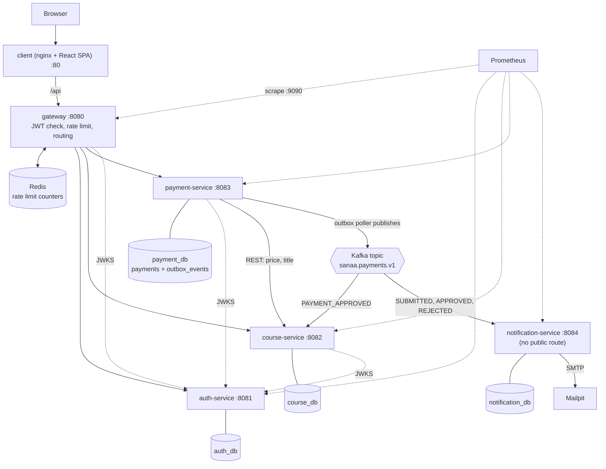

# SANAA Architecture (v1.0.0)

Companion documents: `AGENTS.md` (repository root, agent rules) and `docs/Design.md` (UI design system, Arco Design).

Status: source of truth for the v1.0.0 design. If the code and this document disagree, either fix the code or update this document in the same commit. Do not add components, libraries or features that are not described here without writing an ADR in `docs/adr/`.

## 1. Purpose and scope

SANAA is a multi-tenant e-learning platform. Organizations (tenants) publish video courses, students pay by bank wire or CashPlus receipt, a tenant admin approves the payment, and the student gets access to protected video playback.

It is a portfolio and learning project. It is built to demonstrate service boundaries, tenant isolation, asynchronous messaging and token-gated media delivery, not to run a commercial business.

In scope for v1.0.0:

- API gateway with JWT validation and Redis rate limiting
- Four backend services: auth, course, payment, notification
- Shared library `common` (tenant context, roles, event envelope, JWT constants)
- React + TypeScript single-page client
- Docker Compose environment, Flyway migrations, Actuator/Prometheus metrics, GitHub Actions CI

Out of scope (do not implement): Google login, Stripe/PayPal, real DRM (Widevine/FairPlay), WhatsApp, Eureka, Config Server, Grafana, MinIO, lesson progress tracking, forensic watermarking.

## 2. System diagram



## 3. Components

| Component | Port | Responsibility | Owns |
|---|---|---|---|
| client (nginx) | 80 | Serves the SPA, proxies `/api` to the gateway, overwrites `X-Forwarded-For` with `$remote_addr` | none |
| gateway | 8080 | JWT validation, Redis rate limiting, routing, Host-vs-tenant check, strips inbound `X-Tenant*` and `X-User*` headers | none |
| auth-service | 8081 | Tenants, users, login, registration, refresh tokens, JWT signing, JWKS endpoint | `auth_db` |
| course-service | 8082 | Courses, modules, lessons, enrollments, playback tokens, HLS delivery, consumes payment events | `course_db` |
| payment-service | 8083 | Payment submission, receipt storage, approve/reject, transactional outbox | `payment_db` |
| notification-service | 8084 | Consumes payment events, sends emails, no REST API | `notification_db` |
| common | n/a | Library: `TenantContext`, Hibernate tenant resolver, `Role` enum, claim constants, `EventEnvelope`, `JwtTenantFilter` | none |

Management (Actuator) runs on port 9090 of every backend component via `management.server.port`. It is not published outside the Compose network. Only `health`, `info` and `prometheus` are exposed. When running several services from the IDE, override `MANAGEMENT_SERVER_PORT` per service (9081 to 9085) to avoid port collisions; inside Compose each container keeps 9090.

Infrastructure containers: MySQL 8.4, Redis 7, Kafka (single-node KRaft), Mailpit, Prometheus.

Published ports in the `full` profile: gateway 8080 and client 80 only. Tool UIs (Mailpit 8025, Prometheus 9091) and infra host ports (MySQL 3306, Redis 6379, Kafka 29092) bind to `127.0.0.1`.

## 4. Design decisions

1. **Database per service, one MySQL server.** Each service has its own schema and database user. No cross-database joins. A production setup would use separate instances.
2. **Tenant comes only from the validated JWT claim.** Request headers, query parameters and bodies are never trusted for tenant identity. The only unauthenticated tenant input is `tenantSlug` on login and register, which auth-service resolves itself. In Kafka consumers the tenant comes from the event envelope.
3. **Every service validates the JWT itself** (zero trust). The gateway adds early rejection, rate limiting and the Host check, but is not the only enforcement point.
4. **Payment approval triggers enrollment through an event**, not a synchronous call. Eventual consistency: a student may wait a moment after approval.
5. **Transactional outbox** avoids the dual-write problem between MySQL and Kafka. Delivery is at-least-once, so consumers are idempotent.
6. **Shared `common` library** contains only tenant context, role constants, claim names and event DTOs. No entities are shared. Cost: a change to `common` forces a coordinated release of all services.
7. **No Eureka and no Config Server.** Docker DNS handles discovery and environment variables handle configuration. For four services these would add complexity without benefit.

## 5. Multi-tenancy

Strategy: shared database, discriminator column, Hibernate 7 `@TenantId`.

Request flow:

1. A JWT carries `tenant_id`.
2. `JwtTenantFilter` (from `common`) copies the claim into `TenantContext` (a `ThreadLocal`) after authentication and clears it in a `finally` block.
3. The Hibernate `CurrentTenantIdentifierResolver` reads `TenantContext`.
4. `@TenantId` adds the tenant predicate to queries and sets the column on insert.

Rules:

- `TenantContext` must be set before the transaction or Hibernate session starts. In consumers, use a non-transactional listener that sets the context and then calls a separate `@Transactional` bean.
- The resolver is fail-closed: when no tenant is set it returns the nil UUID `00000000-0000-0000-0000-000000000000`. Reads match nothing. Inserts are rejected by `CONSTRAINT chk_tenant_not_nil CHECK (tenant_id <> '00000000-0000-0000-0000-000000000000')` on every tenant-owned table.
- The gateway is reactive (Netty). It must not rely on `ThreadLocal`. It forwards the token; downstream services derive the tenant themselves.
- Tests must prove that `@TenantId` filters `find`, queries and updates. If `find` by id is not filtered in the resolved Hibernate version, use an explicit JPQL query method and record it in `docs/adr/001-tenancy.md`.
- Native SQL on tenant-owned tables is forbidden. The only native query is the outbox poller, because `outbox_events` is intentionally not tenant-scoped.
- Unique indexes on tenant-owned tables include `tenant_id`.
- `SUPER_ADMIN` manages tenants only and has no access to tenant content.

Known limits (documented in `docs/adr/001-tenancy.md`): native queries are not filtered, noisy-neighbor effects in a shared database, and large tenants would eventually need their own database.

## 6. Authentication and authorization

Roles: `SUPER_ADMIN`, `TENANT_ADMIN`, `INSTRUCTOR`, `STUDENT`. Enforced with Spring Security 6 method security (`@EnableMethodSecurity`) in each service.

Access token (JWT, RS256, 15 minutes):

| Claim | Meaning |
|---|---|
| `iss` | `sanaa-auth` |
| `aud` | `sanaa-api` |
| `sub` | user id |
| `tenant_id` | tenant UUID |
| `tenant_slug` | tenant subdomain label |
| `role` | one of the four roles |
| `email`, `name` | display data |
| `jti` | token id |

Signing keys are RSA 2048, loaded from file paths in environment variables. Public keys are served at `/.well-known/jwks.json`. Resource servers validate signature, `exp`, issuer and audience.

Refresh token: opaque, 256-bit random, stored only as SHA-256 hash, valid 7 days, rotated on every use. If a revoked token is presented, all tokens of that user are revoked. Delivered in a cookie: `HttpOnly; SameSite=Strict; Path=/api/auth`, `Secure` configurable. The refresh lookup is by hash and is not tenant-scoped; the tenant is taken from the row afterwards.

The SPA keeps the access token in memory only (never `localStorage`) and restores the session by calling `/api/auth/refresh` on load.

## 7. Gateway behavior

- OAuth2 resource server using the auth-service JWKS URI, with issuer and audience validators.
- Public routes: `POST /api/auth/login|register|refresh|logout`, `GET /api/auth/tenants/*/branding`, `/api/stream/media/**` (validated by course-service with the playback token).
- Routes: `/api/auth/**` and `/api/platform/**` to auth; `/api/courses/**`, `/api/modules/**`, `/api/lessons/**`, `/api/enrollments/**`, `/api/stream/**` to course; `/api/payments/**` to payment. No route to notification-service. No route exposing Actuator.
- Redis `RequestRateLimiter` policies:

| Policy | Applies to | Key | Rate | Burst |
|---|---|---|---|---|
| A | `/api/auth/login`, `/register`, `/refresh` | client IP | 2/s | 10 |
| B | other `/api/**` | `tenant_id:sub` | 20/s | 40 |
| C | `/api/stream/media/**` | IP + path prefix | 50/s | 100 |

- Client IP is resolved with `XForwardedRemoteAddressResolver.maxTrustedIndex(1)`. Key resolvers never return empty.
- A global filter removes inbound `X-Tenant*` and `X-User*` headers. If the Host subdomain differs from the token's `tenant_slug`, the response is 403.
- Timeouts: connect 5 s, response 30 s. Errors use ProblemDetail-style JSON.
- The Redis limiter fails open if Redis is unavailable. This is documented and accepted.
- Spring Cloud 2025.1 uses the `spring-cloud-starter-gateway-server-webflux` starter and the `spring.cloud.gateway.server.webflux.*` property prefix. Confirm names against the 2025.1 reference docs before use.
- Browser traffic is same-origin through nginx, so no CORS configuration is needed. The Vite dev server proxies `/api` for the same reason.

## 8. Data model

Conventions: `utf8mb4`, `created_at` and `updated_at` timestamps, money as `DECIMAL(10,2)`, ids as `BIGINT AUTO_INCREMENT` (tenants use `CHAR(36)` UUID). Tenant-owned tables have `tenant_id CHAR(36) NOT NULL`, the nil-UUID CHECK, and a composite index starting with `tenant_id`. All schema changes are Flyway migrations; `ddl-auto=validate`; `open-in-view=false`.

### auth_db

| Table | Key columns | Notes |
|---|---|---|
| `tenants` | id, slug (unique, `^[a-z0-9-]{3,63}$`), name, status (ACTIVE, SUSPENDED), primary_color, logo_url | not tenant-scoped |
| `users` | id, tenant_id, email, password_hash, full_name, role, status | `@TenantId`; `UNIQUE(tenant_id, email)`; BCrypt |
| `refresh_tokens` | id, tenant_id, user_id, token_hash (unique), expires_at, revoked_at | not `@TenantId` (lookup by hash) |

### course_db

| Table | Key columns | Notes |
|---|---|---|
| `courses` | id, tenant_id, title, description, price, currency (default MAD), status (DRAFT, PUBLISHED, ARCHIVED), instructor_id, version | `@TenantId`, `@Version` |
| `modules` | id, tenant_id, course_id, title, position | `UNIQUE(course_id, position)` |
| `lessons` | id, tenant_id, course_id, module_id, title, position, duration_seconds, media_status (NONE, READY), free_preview | `course_id` denormalized for fast entitlement checks |
| `enrollments` | id, tenant_id, user_id, course_id, source_payment_id, status (ACTIVE, REVOKED), enrolled_at | `UNIQUE(tenant_id, user_id, course_id)` is the final duplicate guard |
| `processed_events` | event_id (PK), processed_at | consumer idempotency |

### payment_db

| Table | Key columns | Notes |
|---|---|---|
| `payments` | id, tenant_id, user_id, user_email, user_name, course_id, course_title, amount, currency, method (BANK_WIRE, CASHPLUS), status (PENDING_REVIEW, APPROVED, REJECTED), receipt_path, receipt_content_type, reviewed_by, reviewed_at, rejection_reason, version | `@TenantId`, `@Version`; email, name and title are snapshots so notifications need no lookups |
| `outbox_events` | id, event_id (unique), tenant_id, aggregate_id, event_type, topic, payload JSON, created_at, published_at | not `@TenantId` (poller is cross-tenant); index on `(published_at, id)` |

Optional hardening: a stored generated column `active_key` (non-null only for PENDING_REVIEW and APPROVED) with a unique index, preventing two open payments for the same user and course.

### notification_db

`processed_events` (same shape as above) and `notification_log` (id, tenant_id, event_id, recipient_email, type, status SENT or FAILED, error, created_at).

## 9. Event flow

Topic: `sanaa.payments.v1` (3 partitions), key = payment id. Dead-letter topic: `sanaa.payments.v1.DLT`.

Envelope (JSON string):

```json
{
  "eventId": "uuid",
  "eventType": "PAYMENT_APPROVED",
  "occurredAt": "2026-01-01T12:00:00Z",
  "tenantId": "uuid",
  "payload": {
    "paymentId": 1, "userId": 5, "userEmail": "...", "userName": "...",
    "courseId": 9, "courseTitle": "...", "amount": "299.00", "currency": "MAD"
  }
}
```

Event types: `PAYMENT_SUBMITTED`, `PAYMENT_APPROVED`, `PAYMENT_REJECTED` (the last carries `reason`).

Serialization uses `StringSerializer` and the service's own Jackson 3 `JsonMapper`, not Spring's `JsonDeserializer`. Producer: `acks=all`, `enable.idempotence=true`.

Approval sequence:

1. TENANT_ADMIN calls `POST /api/payments/{id}/approve`.
2. In one transaction payment-service sets status APPROVED (optimistic lock) and inserts the outbox row.
3. `OutboxPoller` (every 1 s) selects up to 50 unpublished rows `FOR UPDATE SKIP LOCKED`, sends each with an acknowledged send (5 s timeout), sets `published_at`, commits. On failure the row stays for the next cycle.
4. course-service consumes `PAYMENT_APPROVED`: sets `TenantContext` from the envelope, then in one transaction inserts `event_id` into `processed_events` (duplicate key means skip) and creates the ACTIVE enrollment (an existing one counts as success).
5. notification-service consumes all three types with the same idempotency pattern, renders a Thymeleaf template (French, HTML-escaped values), sends via SMTP to Mailpit and writes `notification_log`. A send failure rolls back so retry applies.

Error handling in consumers: `DefaultErrorHandler` with exponential backoff (3 retries) and `DeadLetterPublishingRecoverer` to the DLT. Deserialization and poison messages are non-retryable.

Guarantees and trade-offs: at-least-once delivery. A crash between sending an email and committing can cause one duplicate email. Approval succeeds while Kafka is down and the event is delivered later.

## 10. Payments and receipts

- `POST /api/payments` is multipart (`courseId`, `method`, receipt file), STUDENT only.
- Amount and title come from course-service (REST via `RestClient`, forwarding the caller's bearer token, connect 2 s, read 5 s). The course must be PUBLISHED. Amount and title are never taken from the client.
- Receipts: maximum 5 MB, JPEG, PNG or PDF verified by magic bytes, stored under a random UUID filename behind a `ReceiptStorage` interface, outside any web root. The original filename is never used.
- Download: owner or TENANT_ADMIN only, with `Content-Disposition: attachment` and `X-Content-Type-Options: nosniff`.
- Approve and reject are allowed only from PENDING_REVIEW; otherwise 409.

## 11. Protected streaming

This is content protection, not DRM. An enrolled user can still extract the key and segments. See `docs/adr/002-streaming.md`.

Storage: `/data/media/{tenantId}/{lessonId}/` containing `index.m3u8`, `seg_NNN.ts`, `key.bin`, produced by `scripts/package-hls.sh` (AES-128 HLS, 6 s segments, VOD).

Flow:

1. `POST /api/stream/lessons/{id}/token` authorizes one of: STUDENT with an ACTIVE enrollment on a PUBLISHED course, lesson marked `free_preview`, INSTRUCTOR owner, TENANT_ADMIN.
2. course-service issues a playback token: HS256, 120 seconds, `aud=sanaa-playback`, claims `sub`, `tenant_id`, `lesson_id`, `jti`, signed with a separate secret.
3. The client fetches `/api/stream/media/{lessonId}/index.m3u8`, `/key` and `/seg_NNN.ts` with `Authorization: Bearer <playback token>` (hls.js `xhrSetup`) and refreshes the token every 90 seconds.
4. Media endpoints use a separate `SecurityFilterChain` (`@Order(1)`, matcher `/api/stream/media/**`). An access token is rejected there, and a playback token is rejected on the API.

Safeguards: the file path is built from the token's `tenant_id` and the path lesson id, never from request input; file names must match `^seg_\d{3,6}\.ts$`, `index.m3u8` or `key`; the resolved path must stay inside the lesson directory; segments support HTTP Range; the key response is `Cache-Control: no-store`.

The on-screen watermark (email plus time, repositioned every 5 s) is a client-side deterrent, not forensic protection.

## 12. REST API summary

All paths are under `/api` through the gateway.

| Service | Endpoints | Roles |
|---|---|---|
| auth | `POST /auth/register`, `/auth/login`, `/auth/refresh`, `/auth/logout`; `GET /auth/tenants/{slug}/branding` | public |
| auth | `GET /auth/me` | any authenticated |
| auth | `POST /auth/admin/users` | TENANT_ADMIN |
| auth | `POST /platform/tenants`, `GET /platform/tenants`, `PATCH /platform/tenants/{id}/status` | SUPER_ADMIN |
| course | `GET /courses`, `GET /courses/{id}` | authenticated (visibility depends on role) |
| course | `POST/PUT /courses`, `PATCH /courses/{id}/publish`, `POST /courses/{id}/modules`, `POST /modules/{id}/lessons`, `PUT /lessons/{id}/media` | INSTRUCTOR (own courses), TENANT_ADMIN |
| course | `GET /enrollments/me` | STUDENT |
| course | `POST /stream/lessons/{id}/token` | entitled user |
| course | `GET /stream/media/{lessonId}/index.m3u8`, `/key`, `/seg_NNN.ts` | playback token |
| payment | `POST /payments`, `GET /payments/me` | STUDENT |
| payment | `GET /payments?status=`, `POST /payments/{id}/approve`, `/reject` | TENANT_ADMIN |
| payment | `GET /payments/{id}/receipt` | owner or TENANT_ADMIN |

Errors are RFC 7807 `ProblemDetail` from a `@RestControllerAdvice`. Entities are never returned; controllers use Java record DTOs with Bean Validation.

## 13. Client: tenant resolution and UI

The SPA derives the tenant slug from the first hostname label (`*.localhost` or the configured base domain), falling back to `?tenant=` or `VITE_DEFAULT_TENANT`. It loads branding from `/api/auth/tenants/{slug}/branding` and applies it as CSS variables. This is display only; authorization always uses the JWT claim.

UI rules: the interface uses Arco Design (`@arco-design/web-react`) and follows `docs/Design.md`. Tenant branding overrides the primary color by setting `--primary-6` as an RGB triplet. Dark mode uses the `arco-theme` body attribute. No second UI framework (no Tailwind) is added. Arco compatibility with React 19 must be verified; if it cannot be made to work cleanly, use React 18 and record the decision in `docs/adr/003-frontend.md`.

## 14. Infrastructure

Docker Compose profiles:

- `infra`: MySQL, Redis, Kafka, Mailpit, Prometheus. Services run from the IDE. Kafka host listener is `localhost:29092`.
- `full`: infra plus gateway, four services and client. Services use `kafka:9092`.

Rules:

- Every container has a healthcheck, and dependents use `depends_on: condition: service_healthy`.
- MySQL init script creates four databases and four users from environment variables.
- Service Dockerfiles are multi-stage (Maven build on `eclipse-temurin:27-jdk`, run on `27-jre`; confirm the tags exist), run as non-root, and use the repository root as build context because of `common`.
- The MySQL init script runs only on an empty data volume. Changing database users or passwords requires `docker compose down -v`, which deletes data.
- Shell scripts and the MySQL init script must use LF line endings (enforced by `.gitattributes`), otherwise they fail inside Linux containers.
- Secrets come from `.env` (gitignored; `.env.example` committed). JWT keys are generated by `scripts/gen-jwt-keys.sh` into a gitignored `secrets/` directory.
- Media is a bind mount `./data/media:/data/media`. Receipts use the named volume `receipts-data`.
- nginx overwrites `X-Forwarded-For` with `$remote_addr` so clients cannot spoof it.

Stack: Java 27, Spring Boot 4.1.2, Spring Framework 7, Spring Security 7, Hibernate 7, Spring Cloud 2025.1.4, Testcontainers 2.x, Jackson 3, MySQL 8.4, Redis 7, Kafka (KRaft), React 19 (see UI rules), TypeScript, Vite, Arco Design, TanStack Query. Versions managed by the Spring BOMs are not hand-pinned.

Resolved versions (filled in after the first successful build, from `mvn dependency:tree` and the Spring Boot 4.1.2 BOM): Hibernate ORM: 7.4.13.Final. Kafka clients: 4.2.2. Testcontainers: 2.0.5. Jackson: 3.1.7. Arco Design: TBD (frontend not yet scaffolded).

## 15. Observability and CI

- Micrometer metrics with a common `application` tag, exposed at `:9090/actuator/prometheus`. Prometheus scrapes each backend service as its own job. Metrics are never tagged with tenant id (cardinality).
- Logging via SLF4J. Tokens, passwords and receipt contents are never logged.
- GitHub Actions on push and pull request to `main`: backend (`mvn -B verify` with Testcontainers), frontend (`npm ci`, lint, test, build), docker (build images without pushing, `docker compose config -q`).

## 16. Invariants that tests must prove

- Tenant B admin cannot read or modify tenant A's course (404).
- The same email can register in two tenants. A token used with the other tenant's Host gets 403.
- STUDENT gets 403 on admin endpoints. An INSTRUCTOR cannot edit another instructor's course.
- Approving a payment twice returns 409 and produces one event. A duplicate Kafka event creates one enrollment and one email.
- Approval succeeds while Kafka is down, and the event is delivered after Kafka returns.
- A student without enrollment gets 403 on the playback token. An expired playback token gets 401. Cross-lesson, cross-tenant and path-traversal file access fails.
- A burst of login requests returns 429.
- Reusing a rotated refresh token revokes all tokens of that user.
- A suspended tenant cannot log in.
- A receipt requested by another tenant's admin returns 404.
- A file named `.pdf` with non-PDF content is rejected as a receipt.
- An access token is rejected on media endpoints, and a playback token is rejected on the API.
- A clean clone runs with one Compose command and CI is green.

## 17. Known limitations

- The shared `common` library couples releases of all services.
- The Redis rate limiter fails open if Redis is down.
- A suspended tenant's existing access tokens stay valid for up to 15 minutes.
- Emails are at-least-once; a rare duplicate is possible.
- Receipts and media are stored on local disk or a Docker volume, not object storage.
- Streaming is content protection, not DRM.
- All databases share one MySQL server in Compose.
- Java 27 is a non-LTS release. A production deployment would pin an LTS (Java 25). Boot 4.1.x is a recent generation with fewer community examples.

## 18. Future work

MinIO for receipts and media, a real DRM provider behind a `StreamProvider` interface, Grafana dashboards, outbox metrics and alerting, per-tenant rate limits, token revocation on tenant suspension, Google login.